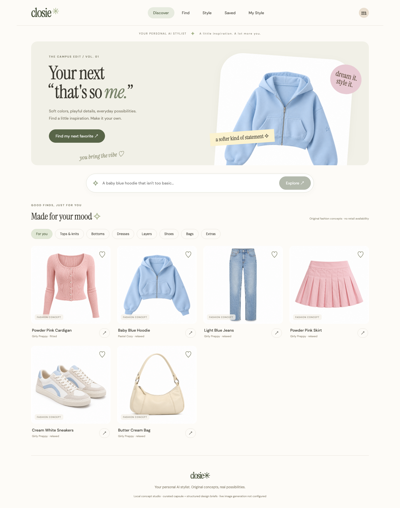
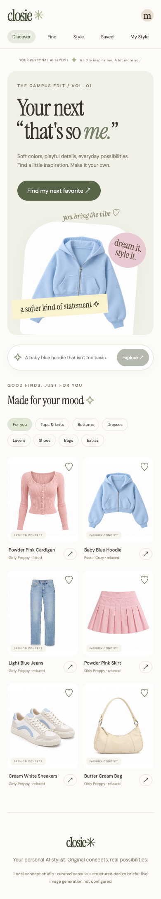

# Closie — Your Personal AI Stylist

Closie helps translate an everyday fashion idea into clothing concepts and outfits, initially focused on **California Campus / Playful Feminine Casual**. The current direction is [V1.1](docs/CLOSIE_V1_1_SPEC.md): **Discover → Find → Style**, including one unified **Style My Item** journey.

**Current boundary:** the local concept studio works with six original, pre-generated garment assets, structured rules, persistent design/version history and a shared outfit engine. Gemini image generation, optional photo analysis and OpenAI brief enhancement have server-side adapters, but **live account access and model quality have not been verified**. No paid application model calls were made. New designs without generated images are labeled **Design brief**. Do not present this release as a verified live AI stylist or a shopping service.

The existing retail catalog, eBay adapter and deletion-notification logic remain in place. Existing retail data is preserved. This branch has not been publicly deployed and does not change the existing Railway site.

## Start locally

Requirements: Java 21, Node 22.12+, pnpm 11 and a running Docker engine/Colima.

```sh
./dev studio
```

Open **http://127.0.0.1:5173**. Keep the terminal open. The launcher creates only the dedicated `closie_studio` database if absent, reuses the existing dedicated PostgreSQL container on **127.0.0.1:55432**, applies additive migrations, compiles the backend and starts Vite. It refuses occupied app ports and unexpected database mappings. It never uses the unrelated database on 5432. The studio profile guards the database URL before Flyway and binds the backend to localhost.

```sh
./dev stop
```

Stops this checkout's application processes; databases and saved files remain. Logs and PIDs are under ignored `.local/`. Default `./dev` now starts the studio. Existing `./dev demo` and `./dev live` modes remain available, using `closie_demo` and `fashion_search` respectively. The old React experience loads when the studio API is disabled, or explicitly through `?retail=1`.

Manual start, once the isolated database exists:

```sh
SPRING_PROFILES_ACTIVE=studio ./mvnw spring-boot:run
# another terminal
cd frontend
pnpm install --frozen-lockfile
pnpm dev
```

Only the launcher loads optional ignored `.env.local`; ordinary Spring startup needs environment variables configured separately. Vite proxies `/api`, `/concepts` and `/demo` to backend 8080; `CLOSIE_API_URL` overrides the development target.

## User journeys

- **Discover:** original white-background capsule, typed categories, rankings from selected aesthetics/colors/saves, favorite and hidden preferences stored in PostgreSQL for the current anonymous browser. No image calls on homepage load.
- **Find:** ordinary English requests become validated briefs. Broad ideas yield cardigan/hoodie/skirt directions; garment-specific ideas offer construction variants. Exact structured designs reuse available concepts. Other directions remain honest briefs until a provider image succeeds. Optional validated language-model enhancement falls back to explicit rules. “Make it pink,” fitted/neckline/detail edits and ordinal selection retain the chosen concept context.
- **Concept versions:** edits fork shared originals into private concepts; subsequent edits append revisions. Briefs, reference images, parent versions and generation provenance persist. Versions can be revisited/restored. A failed image job preserves old versions; edited briefs do not borrow a mismatched old image.
- **Style This:** select a concept to create a persistent outfit board. The shared rules engine preserves the exact anchor reference and combines available complementary slots. Replace a single non-anchor piece, leaving others unchanged. Board revisions are restorable.
- **Style My Item:** photo, brand/model and HTTPS product link all converge on identification → correction/confirmation → OwnedItem → the same outfit engine. The original source photo stays on the board. Missing retailer matches never block manual confirmation/styling.
- **Photo analysis:** optional Gemini adapter requires both operator opt-in/budget and an explicit per-photo consent checkbox. Otherwise visible garment attributes are entered/confirmed manually. AI suggestions are not verified retail facts.
- **Saved / My Style:** favorites and explicit aesthetic/color preferences persist for that browser. Lifestyle and future shopping budget can be stored; these do not invent concept prices or enforce a purchase budget. Preferences and favorites can be reset.
- **Doll preview:** opt-in durable image job, with approximate-visualization labeling. No pre-generated doll is passed off as a live result. Actual doll quality remains unverified.

Rules are deliberately limited vocabulary, not a claim of unrestricted conversation or semantic embeddings. The capsule has two tops, two bottoms, one shoe pair and one bag; dress/layer/accessory discovery may honestly be empty. With only one shoe design, replacing shoes cannot yet offer visual diversity.

## Architecture and persistence

Java 21 / Spring Boot / JDBC + existing JPA / Flyway / PostgreSQL; React 19 / Vite; JUnit, Mockito, PostgreSQL Testcontainers and Playwright.

```text
React Studio / anonymous browser capability
             ↓ validated REST
StudioService → DesignBriefEngine → StyleLibrary → precise prompt
       ↓              ↓ optional OpenAI              ↓
Shared outfit engine                         durable StudioJobs
       ↓                                             ↓
Concept / OwnedItem references                ImageGenerationProvider
       ↓                                             ↓
PostgreSQL JSONB + append-only versions           GeminiImages
       ↓                                             ↓
Private file store ← file validation + metadata removal
```

Distinct types: **FashionConcept** has no commerce facts; **OwnedItem** separates user-confirmed attributes from source/match evidence; existing **RetailProduct** facts stay in the authorized catalog boundary. No generated brand, price, stock or buying URL is added to concepts.

V1–V5 retain the catalog/import/deletion schema. Additive **V6** adds studio documents (concept/owned/outfit/profile), append-only revision records with parent references, private asset references, durable generation jobs and a model-usage ledger. **V7** adds a stable append sequence, backfilling old revisions without changing IDs or parent links; timestamps alone cannot order multiple appends in one transaction. Java DTOs validate JSONB documents. Retail entity mapping and records are unchanged.

Private generated/uploaded files live in `.local/studio-assets` by default, with database references. Anonymous 256-bit browser tokens are stored locally and hashed server-side for ownership checks; they are never query-string asset credentials. Private images require the session header and are displayed as browser blob URLs. Curated originals are intentionally public project assets. This is browser-scoped persistence, not an account/login or cross-device sync system. Losing browser storage loses access to that anonymous studio; back up both its capability and private data appropriately.

PNG/JPEG uploads are limited to 8 MB and 16 megapixels, checked before full raster decode, resized to at most 1600 pixels and re-encoded without original metadata. Item/photo deletion controls and unattached-photo cleanup are available. Local file storage needs a persistent volume/object-store adapter before a cloud release.

## Providers and safeguards

Configuration is backend-only; never put keys in Vite variables or Git. See `.env.example`.

- `CLOSIE_GENERATION_ENABLED=false`, `GEMINI_API_KEY`, `GEMINI_IMAGE_MODEL`: explicitly opt in to garment/doll generation. Model name is **unset by default**; use an image-capable model available to the account, verified through Google's model API before each generation. The configured adapter uses the documented GenerateContent image interface; alternative providers implement `ImageGenerationProvider`.
- `CLOSIE_GENERATION_DAILY_LIMIT=12`: global rolling 24-hour job cap; at most six jobs per browser in that period. Existing queued/running/successful requests for a revision/operation are deduplicated. Cancelled/failed attempts still consume reservations. One durable claim at a time per worker; model requests have deadlines and bounded response sizes.
- Failed or interrupted requests are **not automatically replayed**, because they may already have been billed. Retry is explicit, budgeted and preserves the original. A cancellation discards subsequent results; it cannot guarantee upstream billing cancellation.
- `CLOSIE_AI_ENABLED`, `OPENAI_API_KEY`, `OPENAI_MODEL`, plus **`CLOSIE_TEXT_DAILY_LIMIT=0`**: optional structured design-brief interpretation. A positive limit is an additional explicit budget opt-in. Output is validated; errors/limits fall back to curated rules.
- `CLOSIE_VISION_ENABLED=false`, `GEMINI_VISION_MODEL`, same Gemini key and a positive text limit: optional photo interpretation, after per-photo consent. Vision and brief enhancement share a durable text-call ledger. No private retailer content is sent for model curation.
- `CLOSIE_ASSET_PATH`: private asset directory; ignored default is local only.

Image generation receives the structured brief rather than the raw sentence alone. Localized edits pass the available original reference image. File validation does not prove garment realism or visual adherence; all generated results require human review. Provenance/prompts for curated files are in [CONCEPT_ASSETS.md](docs/CONCEPT_ASSETS.md). Provider APIs were checked against [Google's image generation docs](https://ai.google.dev/gemini-api/docs/generate-content/image-generation) and [image understanding docs](https://ai.google.dev/gemini-api/docs/generate-content/image-understanding).

## Owned-item lookup boundary

Lookup examines a bounded page of **currently display-eligible authorized catalog records**. An exact stored product URL yields `EXACT_VERIFIED` source evidence; name overlap yields `POSSIBLE_MATCH`, never exact SKU verification. Otherwise it returns `NOT_FOUND`. This does not guarantee exhaustive retailer search. The isolated studio database starts without retail inventory, so missing matches are expected.

URLs are validated as HTTPS and compared to permitted existing records. No arbitrary retailer-page fetch, scraping, access-control bypass or invented retailer partnership is implemented. Candidate evidence is separate from user-confirmed garment properties; a match does not bypass user confirmation.

## API

Studio routes exist only when the studio feature is enabled. Private routes require `X-Studio-Session` with a 64-character cryptographically random hex capability.

- `GET /api/studio/status`, `/discover?category=TOP`, `/items?kind=CONCEPT|OWNED|OUTFIT`, `/items/{id}`
- `POST /api/studio/find`: message + optional conceptId/revisionId for a localized follow-up
- `GET/PUT /api/studio/preferences`
- `POST /api/studio/items/{id}/revert`, `/items/{id}/generate`
- `POST /api/studio/uploads` (multipart), `GET /uploads`, `GET/DELETE /assets/{id}`
- `POST /api/studio/owned/identify`, `/owned/{id}/confirm`
- `POST /api/studio/outfits`, `/outfits/{id}/replace`, `/outfits/{id}/doll`
- `GET /api/studio/jobs`, `/jobs/{id}`; `POST /jobs/{id}/cancel`
- `DELETE /api/studio/items/{id}`

Existing retail APIs and authenticated import callbacks remain unchanged. Historical retail architecture/startup notes are preserved in [RETAIL_README_HISTORICAL.md](docs/RETAIL_README_HISTORICAL.md); historical verification claims there do not establish current studio behavior.

## Tests

```sh
./mvnw test
cd frontend
pnpm build
cd ..
CLOSIE_BROWSER_SMOKE=true ./mvnw test
```

For macOS/Colima, set `DOCKER_HOST=unix://$HOME/.colima/default/docker.sock` and `TESTCONTAINERS_DOCKER_SOCKET_OVERRIDE=/var/run/docker.sock` if required. `CLOSIE_NODE` can point to the installed Node binary. Testcontainers uses disposable databases, not development/production databases. Browser suites start Vite on 5174 (retail) and 5175 (studio), proxying the actual random-port test backend. Model transport tests use local HTTP fixtures, never paid calls.

See [STUDIO_VERIFICATION.md](docs/STUDIO_VERIFICATION.md) for final observed results and [MODEL_EVALUATION.md](docs/MODEL_EVALUATION.md) for the twenty-request **not-yet-run** live evaluation protocol.

## Screenshots

Original pre-generated concept capsule; not retailer inventory or proof of live Gemini calls.




## Release limitations

This is a locally reviewable concept-studio MVP foundation. Verified live image/vision/brief generation and human aesthetic acceptance remain required before claiming the complete AI MVP. Broader capsule coverage, richer constraint/ranking logic, permitted multi-retailer lookup, cloud-persistent asset storage, authenticated accounts and public abuse protection remain future work. Do not deploy this local anonymous workspace as a public multi-user product without those changes and explicit approval.
