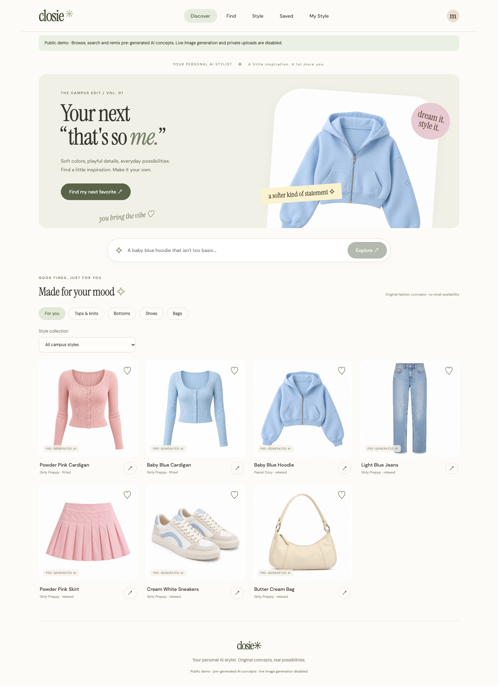
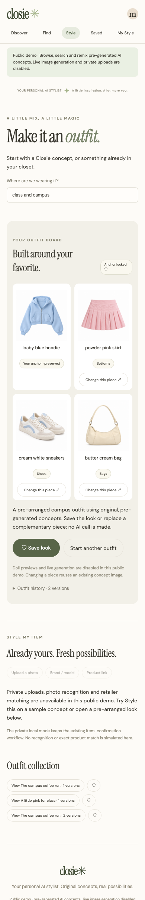

# Closie — Your Personal AI Stylist

Closie is a California-campus fashion inspiration and styling portfolio project. **Discover → Find → Style** connects a cohesive capsule of original AI fashion concepts with natural-language catalog search, favorites and outfit boards.

**Demo v1.0 is a non-billable public-demo configuration.** It searches and remixes existing pre-generated images; it does not claim to create a new live AI result. Visitors cannot trigger image generation, model-assisted interpretation, photo recognition, uploads, retailer lookup or administrative APIs. Private live-AI tools remain available locally in a separate mode.

There are no invented retail prices, brands, inventory or purchase links on concepts. Existing retail/eBay integrations and data are preserved separately; the public demo does not present a marketplace feed.

## Run the public demo locally

Requirements: Java 21, Node 22.12+, pnpm 11, Docker/Colima. The desktop launcher can reuse its already installed Node/pnpm runtime.

```sh
./dev public-demo
```

Open **http://127.0.0.1:5176** (backend 8082). No model key is needed. This mode removes OpenAI/Gemini keys from child environments and uses only the dedicated `closie_public_demo` database in the existing local PostgreSQL container on 127.0.0.1:55432. It does not stop the private application on 5173/8080 or use its database. Keep the terminal open.

```sh
./dev stop-public
```

Application processes stop; database data remain. Logs are in ignored `.local/public-demo/`. The launcher refuses occupied ports and unexpected database mappings.

For a production-artifact rehearsal, see [deployment instructions](docs/PUBLIC_DEMO_DEPLOYMENT.md), `docker-compose.public-demo.yml` and the local-only smoke scripts under `scripts/check_public_demo*`. The root Dockerfile builds React into the Spring Boot artifact and defaults to the `public-demo` profile. No cloud deployment has been performed by this release task.

## Demo walkthrough

1. **Discover:** browse seven pre-generated concepts, category buttons and five curated campus-style collections. Select explicit preferences in My Style to change ranking. Favorite a concept with its heart.
2. **Find:** try “a fitted pink cardigan,” “baby blue hoodie,” “jeans for class” or “white shoes.” Search returns existing capsule records, with garment/color constraints and useful empty states. Refine a selected cardigan with “make it pink” to search matching existing pieces; no new image is fabricated.
3. **Style:** choose Style this, or view one of two pre-arranged outfit examples. The anchor stays locked. Replace an available complementary piece, save the look and revisit it from Saved. Editing a shared sample forks a private browser-scoped board rather than altering the original.
4. **Style My Item:** the public page clearly explains that private uploads, recognition and retail matching are unavailable. It does not simulate recognition or exact product matches.

The capsule covers tops, bottoms, shoes and bags. It has only one shoe design and one bag; replacement variety is limited. Dresses, outerwear and jewelry are not represented. Keyword/structured search is deliberately bounded, not unrestricted semantic or conversational intelligence.

## Architecture and data

Java 21 / Spring Boot 4 / Spring MVC / JDBC + existing JPA / Flyway / PostgreSQL with pgvector; React 19 / Vite; JUnit, Mockito, Testcontainers and Playwright.

- `frontend/src/studio/`: existing visual identity, concept feed, search, preferences, shared styling board and favorites. Public mode adapts capabilities and labels without replacing the UI.
- `studio/StudioService`, `DemoConceptSearch`, `PublicDemoCatalog`: existing structured briefs and styling logic, bounded catalog retrieval, idempotent public samples and copy-on-edit boards.
- `demo/PublicDemoPolicy`, `PublicDemoFilter`: profile/property-based policy and a public route allowlist. The public profile remains non-billable even if provider keys or enable flags are accidentally supplied. Model gateways and the generation worker enforce the policy independently of the UI.
- `ImageGenerationProvider`, `OpenAiImages`, `GeminiImages`: preserved private generation/edit interfaces; model calls are disabled in public mode.
- `ProductSource` / eBay adapter / existing retail APIs: retained for future authorized shopping integrations; public access is blocked.

V1–V5 preserve retail/import/deletion tables. V6 stores concepts, owned items, profiles, outfits, revisions, assets and generation jobs. V7 provides stable revision ordering; V8 stores request fingerprints and permanent private image-spend reservations. This release uses additive/idempotent sample seeding and does not rewrite applied migrations or delete existing records.

## Public safety and persistence

Public anonymous visitors can search, select preferences, save favorites and create/replace outfit boards. They cannot access paid generation, quotes/budget internals, private image assets, uploads, owned-item recognition, import, legacy AI endpoints or debug/admin routes. Both direct HTTP restrictions and model-layer checks are tested. Request bodies are bounded at 16 KB, and public document/revision storage has global caps.

An opaque 256-bit browser capability is stored in localStorage; the backend stores its hash for ownership. Preferences, favorites and private board copies live in PostgreSQL. This is not an account or automatic cross-device sync system. Clearing browser storage loses access to that anonymous session's saved data. Search history is in-memory UI state. No user uploads are accepted by the public demo.

Public images are immutable original assets in `src/main/resources/static/concepts`, bundled into the image/JAR, so app restart/recreation does not erase them. Saved data need a durable PostgreSQL volume or managed database and backups. The private `.local/studio-assets` directory is not automatically transferred to deployment; hosting private uploads/generation would require separate durable storage.

## Configuration and private local mode

Public hosting requires only `SPRING_PROFILES_ACTIVE=public-demo`, `DB_URL`, `DB_USERNAME`, `DB_PASSWORD` and the platform's `PORT`. Use a dedicated database named `closie_public_demo` with pgvector support. See `ops/public-demo.env.example`; never configure model/import credentials on that service. Public mode startup rejects the known private database names.

Local private modes are preserved:

```sh
./dev studio       # private concepts; generation off by default; closie_studio
./dev openai       # explicit private OpenAI verification mode; requires backend key
./dev demo         # historical illustrative retail sample collection
./dev live         # existing real retail catalog; no sample seeding
./dev stop         # stop only this checkout's private app, preserving data
```

Provider variables are backend-only: `OPENAI_API_KEY`, `OPENAI_IMAGE_MODEL`, `CLOSIE_IMAGE_PROVIDER`, `CLOSIE_GENERATION_ENABLED`, `CLOSIE_OPENAI_MAX_PAID_REQUESTS`; optional Gemini uses `GEMINI_API_KEY`, `GEMINI_IMAGE_MODEL`, `GEMINI_VISION_MODEL`. Text enhancement uses `CLOSIE_AI_ENABLED`, `OPENAI_MODEL`, `CLOSIE_TEXT_DAILY_LIMIT`. The launcher strips provider keys from frontend processes and dependency installation.

The **historical** one-request OpenAI verification succeeded on 2026-10-28 with an estimated $0.00684 cost. This release makes **zero new paid requests**. Live image editing/doll quality and broader AI styling quality remain unverified. See [OpenAI evidence and private budget controls](docs/OPENAI_IMAGES.md). Do not enable private AI in a public service.

## Tests and release evidence

```sh
./mvnw test
cd frontend
pnpm build
cd ..
CLOSIE_BROWSER_SMOKE=true ./mvnw test
```

On macOS/Colima, use `DOCKER_HOST=unix://$HOME/.colima/default/docker.sock` and `TESTCONTAINERS_DOCKER_SOCKET_OVERRIDE=/var/run/docker.sock` if needed. `CLOSIE_NODE` can specify Node's absolute path; Node must also be on `PATH` because Playwright starts Vite in a child shell. Testcontainers uses disposable databases, not the existing local or production databases.

Public, private-studio and historical retail browser suites have separate configurations. Fake-key/unsafe-flag tests verify public HTTP denials and model-layer guards without contacting a real model. Local packaged-artifact checks verify CSP/static assets, search, saved looks and persistence across restart/recreated app containers.

See [final release verification](docs/PUBLIC_DEMO_RELEASE.md), [current progress](PROGRESS.md), [deployment preparation](docs/PUBLIC_DEMO_DEPLOYMENT.md) and [asset provenance](docs/CONCEPT_ASSETS.md). `AGENTS.md` contains concise repository instructions. Historical reports remain dated evidence, not claims of current public features.

## Screenshots

Pre-generated original concepts; not retailer inventory or new live results.




## Deployment decision and future work

Recommended: one Railway Docker web service serving React + Spring, with dedicated durable PostgreSQL; images stay bundled. Neon is an optional managed pgvector-compatible database alternative. Hosting costs, credits and backups need approval before provisioning. No billing changes, public repository publication, branch merge or cloud deployment are part of this preparation.

Remaining limits: a small capsule, rules-based retrieval/styling, no accounts/cross-device sync, no public uploads or shopping availability, and no hosted HTTPS/remote CI verification yet. A source license must be chosen before eventual public source publication. Expansion should improve curated coverage and evaluated quality, not add unverified marketplace imagery or fabricated model claims.

## First PR compatibility notes

This branch includes the retained retail foundation, private concept studio and public Demo v1.0 (not only the final public-profile change). Historical specs/reports are labeled; README and PUBLIC_DEMO_RELEASE.md describe current public behavior. The legacy Railway upload helper is not suitable for this release; follow PUBLIC_DEMO_DEPLOYMENT.md instead.

Compared with the original main branch, local PostgreSQL defaults move from port 5432 to loopback-only 55432; existing installations must review their DB_URL rather than replace/delete a volume. The added retail search APIs return a context/results envelope; they are separate from the public studio APIs. The root Dockerfile defaults to public-demo and requires a dedicated database. This is not a drop-in redeploy of the old retail service. Keep V1 intact and apply subsequent migrations through Flyway.

The GitHub repository is already public. A future branch push will publish its commit history; PR preparation does not push or change visibility. No source LICENSE has been selected. Generated-asset provenance is documented in docs/CONCEPT_ASSETS.md; it does not establish exclusive rights or replace the owner's license decision. Review [PR preparation evidence](docs/PR_PREPARATION.md) before authorizing a push.
